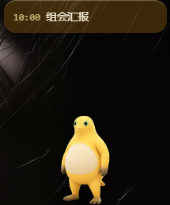
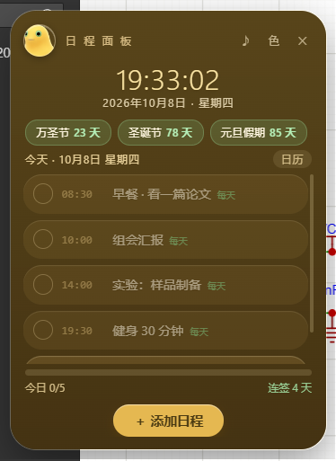
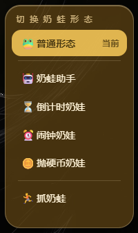
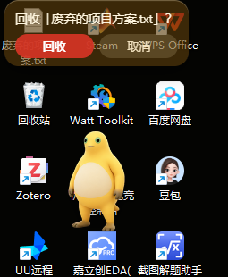
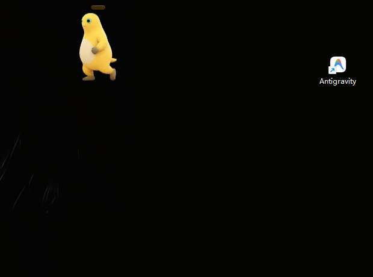

<div align="center">



# Nailong Assistant (奶蛙助手)

**A tiny frog that lives on your Windows desktop: schedule reminders · liquid-glass planner · AI computer-use assistant · mini-games**

[](#)
[](#)
[](LICENSE)
[](https://github.com/wangyiding645/nailong-assistant/stargazers)

[简体中文](README.md) · [English](README_EN.md)

</div>

---

## What is this?

**Nailong Assistant** is a desktop pet that actually does things:

- Nags you (kindly) about your schedule — with a 5-minute heads-up, red flashing bubble and a happy dance when you finish everything
- Ships a **liquid-glass planner**: clock, calendar, countdown chips, check-in streak
- Right-click to switch between **four forms**: AI computer-use assistant / countdown / alarm / coin flip
- Plays **"Catch the Frog"**: it runs around your screen and dodges your cursor
- **Drop a file onto it** — it asks first, then sends it to the Recycle Bin with a victory spin

> Everything works offline. Only the AI assistant needs your own OpenAI-compatible endpoint.

---

## ✨ Features

### 🐸 The pet
- 9 animation sets: idle / run left / run right / wave / belly-laugh / failed / waiting / review / **working** (suit + laptop)
- Drag to move (animation follows direction), position is remembered
- Hover = wave + show today's schedule; click = open planner
- Always on top, comes back automatically after `Win + D`

### 📅 Schedule & reminders
- `schedule.txt`: `HH:MM|text` (daily) or `YYYY-MM-DD HH:MM|text` (one-off)
- On time: red flashing bubble + jumping + chime · 5 min before: gentle pre-alert
- All done → celebration (laugh animation + sound)

### 🪟 Liquid-glass planner
- Live clock, calendar month view with Chinese holiday labels, countdown chips
- Check off items, progress bar, **streak counter**
- 5 glass themes; draggable, remembered position, real blurred-wallpaper backdrop

### 🎛️ Right-click forms

| Form | What it does |
| --- | --- |
| 🐸 Normal | Pet + reminders |
| 🤖 **Assistant** | AI computer use (below) |
| ⏳ Countdown | Quick 1/3/5/10/25 min + custom; live timer chip; 3-note chime at zero |
| ⏰ Alarm | Set hour/minute; two-tone ringing loop; click the frog to stop |
| 🪙 Coin flip | Enter two options, it decides for you (or click the frog) |
| 🏃 Catch the frog | Mini-game: bounces off edges, **turns and flees when your cursor gets close**, lap timer |

### 🤖 AI computer-use assistant
- Sees your screen (screenshots → multimodal model) and **really** drives mouse & keyboard: click / double-click / right-click / type / hotkeys / scroll / wait / launch
- **Step-by-step confirm** (default) or **auto** mode
- Safety: API key encrypted at rest with Windows DPAPI (`safeStorage`); **all pet windows are hidden during screenshots** so the AI never clicks itself or computes wrong coordinates; system prompt forbids destructive actions
- Works with any OpenAI-style API (OpenAI, DeepSeek, Qwen, Kimi, local Ollama…)

<p align="center">  </p>

### 🗑️ Drag-to-recycle
Drop files/folders on the frog → if the icon is on your desktop, **it runs over to the icon** and asks there → confirm → moved to the Recycle Bin (recoverable) + spin & laugh; cancel → it walks home.

<p align="center"> </p>

---

## 🚀 Quick start

### Option A — Download the portable build (recommended)
1. Grab `nailong-assistant-vX.Y.Z-win-x64.zip` from [**Releases**](../../releases)
2. Extract anywhere (a non-system drive is recommended, e.g. `D:\nailong-assistant`)
3. Double-click `奶蛙助手.bat` (make a desktop shortcut if you like)

No installer, no registry writes. Uninstall = delete the folder.

### Option B — From source
```bash
git clone https://github.com/wangyiding645/nailong-assistant.git
cd nailong-assistant
npm install     # only Electron
npm start
```
Requires Windows 10/11 + Node.js 18+.

---

## 🤖 Configure the AI assistant

Right-click the frog → Assistant → ⚙, fill in and hit **Save & test**:

| Field | Example |
| --- | --- |
| Base URL | `https://api.openai.com/v1`, `https://api.deepseek.com/v1`, … |
| API Key | stored encrypted locally, shown as `••••••` |
| Model | must accept images, e.g. `gpt-4o-mini`, `qwen-vl-max` |

---

## 🧠 Engineering notes

<details>
<summary><b>Architecture</b></summary>

- Electron 44, frameless transparent always-on-top windows (pet / planner / assistant / tools / menu)
- Plain local data files (`schedule.txt`, `countdown.txt`, `state.json`) — hand-editable, git-friendly
- `preload.js` contextBridge only; renderers have no Node access
- `native/*.ps1` handles OS-level chores: z-order pinning, restore after Win+D, DPI-aware input injection, wallpaper blur sampling, desktop icon coordinates, Recycle Bin

</details>

<details>
<summary><b>Gotchas we hit (so you don't)</b></summary>

1. `setPosition` on a transparent frameless window **grows it by ~1px per call** → always move with `setBounds`
2. Windows PowerShell 5.1 mis-decodes BOM-less `.ps1` containing CJK → keep scripts ASCII, pass titles as arguments
3. "Semi-transparent belly" pixels in the sprite sheet let the wallpaper bleed through → force interior alpha to 255
4. On Win11 the desktop icon list is **not** a direct child of `Progman` → enumerate all `SysListView32` and require a `Progman/WorkerW` ancestor
5. Cross-process `LVM_GETITEMRECT` needs the address `VirtualAllocEx base + offset` (forgetting the base returns zeros)
6. Screenshots would capture our own windows → `setOpacity(0)` them during capture
7. Assistant losing focus during automation → 📌 pin (`screen-saver` level + visible on fullscreen + watchdog)

</details>

---

## 🗺️ Roadmap

- [ ] NSIS installer + auto-update
- [ ] More forms & mini-games (pomodoro, water reminder)
- [ ] Multi-monitor / multi-DPI polish
- [ ] ICS import/export
- [ ] English UI (i18n)

## ⚠️ Disclaimer

The AI assistant **really controls your mouse and keyboard**. Use step-by-step confirm mode first and never let it handle payments or deletions. Recycle uses the system Recycle Bin (recoverable), but double-check before confirming.

## 🙏 Credits

- Character animations / sound: from the nailong asset library provided by the author. If you are the original artist and want different attribution or licensing, please open an issue.
- Inspired by desktop pets, Tamagotchi and "computer use" agents.

## 📄 License

[MIT](LICENSE) © 2026 nailong-assistant contributors
